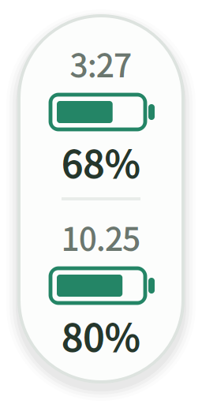

# Codex Quota Float

一个轻量的 Linux 桌面悬浮窗，让 Codex 的五小时和周额度像电池电量一样直接可见。



*预览使用示例数据，不代表真实账户余量。此项目由社区开发，与 OpenAI 无隶属关系。*

## 功能

- 直接显示五小时和每周额度的**剩余百分比**。
- 第一节电池上方显示距重置的 `h:mm` 倒计时，第二节上方显示每周额度重置的本地日期，如 `10.25`；日期、倒计时和额度每 60 秒更新。
- 剩余量 **>50% 绿色、20%～50% 黄色、<20% 红色**。
- 置顶、拖动、记忆位置，支持深色外观。
- 右键可以立即刷新、切换外观或退出；重复启动只显示一个悬浮窗。
- 缺失额度显示 `—`，未知重置时间显示 `--:--`，未知每周重置日期显示 `--.--`；刷新失败时，上次余量变灰。

## 系统要求

- **Linux X11 桌面**。当前仅在此环境验证；Wayland 对窗口定位和置顶的支持取决于桌面环境，Windows / macOS 尚未适配。
- Python **3.10+** 和 PyQt5，依赖由 `requirements.txt` 声明。
- 已安装、并通过 **ChatGPT 账号**登录的 Codex，所用版本需要支持 `codex app-server`。

本程序读取 Codex app-server 的 [`account/rateLimits/read`](https://learn.chatgpt.com/docs/app-server) 接口，选择 `codex` 额度桶中时长为 300 / 10080 分钟的窗口。其他时长、缺失窗口或其他额度桶不会被误显示成满额。

## 安装与启动

从本仓库克隆代码，或下载并解压源码 ZIP，然后在项目目录运行：

```bash
python3 -m venv .venv
.venv/bin/python -m pip install -r requirements.txt
bash run.sh --background
```

若 `venv` 模块不可用，请先通过发行版的包管理器安装 Python 的 venv 支持。

使用 Codex CLI 的用户可先运行 `codex login` 登录。若使用桌面应用附带的 Codex，本程序也会检查常见 Linux 安装位置。

### 自定义 Python 或 Codex 位置

`run.sh` 优先使用 `PYTHON` 指定的解释器，其次是项目 `.venv/bin/python`，最后是 `PATH` 中的 `python3`。

```bash
PYTHON=/path/to/python3 bash run.sh --background
CODEX_BIN=/path/to/codex bash run.sh --background
```

上面的 `/path/to/...` 是需要替换的示例，不是作者的个人路径。Codex 查找顺序为 `CODEX_BIN`、兼容变量 `CODEX_CLI_PATH`、`PATH`，以及常见系统安装位置。显式配置无效时会报错。

## 桌面快捷方式

使用运行此应用的同一个 Python 环境安装：

```bash
.venv/bin/python install_shortcut.py --dry-run
.venv/bin/python install_shortcut.py
```

安装器根据当前电脑的项目位置、解释器和图标生成启动器，不要求所有用户使用同一目录。可以从应用菜单启动，桌面支持快捷方式时也可双击打开。若桌面要求确认，请右键选择“允许启动”。

自定义 Codex 位置也可以保存到启动器：

```bash
CODEX_BIN=/path/to/codex .venv/bin/python install_shortcut.py
```

移动项目或重建虚拟环境后，需要重新生成快捷方式。安装器的其他选项见：

```bash
.venv/bin/python install_shortcut.py --help
```

## 使用与数据位置

- 右键悬浮窗 → **退出悬浮球**，即可关闭。
- 悬浮窗固定在屏幕位置，可拖动到任意角落；不会随 ChatGPT 窗口移动。
- 倒计时不足一分钟时向上取整，到期显示 `0:00`，直到下一次读取到新的重置时间。
- 设置：`${XDG_CONFIG_HOME:-~/.config}/codex-quota-float/settings.json`。
- 后台日志：`${XDG_STATE_HOME:-~/.local/state}/codex-quota-float/app.log`。
- 旧版源码目录中的 `settings.json` 可作为位置与外观的初始值，之后保存到用户配置目录。

程序不直接读取、复制或保存登录凭据；认证由用户自己的 Codex 处理。它不启动模型任务，不监听网络端口；Codex 子进程会自行连接其服务以查询额度，并在读取完成后关闭。默认日志不记录额度百分比或重置时间。应用本身不包含遥测功能。

## 常用命令

```bash
# 前台运行，查看启动错误
bash run.sh

# 检查是否已运行
bash run.sh --status

# 读取一次真实额度后退出（输出包含当前用量数据）
bash run.sh --check

# 离线演示；不读取真实账号
bash run.sh --demo

# 导出只有组件本身的示例预览图
bash run.sh --render preview-widget.png
```

如果出现“未找到 Codex”，请确认 `codex` 在 `PATH` 中，或设置 `CODEX_BIN`。如果提示无法读取账户额度，请先确认所选 Codex 已通过 ChatGPT 账号登录；API key 账户不一定提供相同的套餐窗口。


## 许可证

本项目采用 **GNU GPL v3（GPL-3.0-only）**，完整文本见 [LICENSE](LICENSE)。PyQt5 等依赖的说明见 [THIRD_PARTY_NOTICES.md](THIRD_PARTY_NOTICES.md)。
