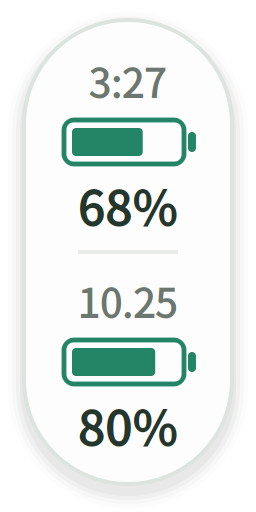

# Codex Quota Float

一个轻量的桌面悬浮窗，让 Codex 的五小时和每周剩余额度像电池电量一样直接可见。

当前发布版本：**v1.1.1**。Windows 提供下载后双击运行的 EXE，Linux 继续使用原版源码。两个系统的源码分别放在 `windows/`、`linux/`，说明和许可证在仓库根目录共用。



*预览使用示例数据，不代表真实账户余量。此项目由社区开发，与 OpenAI 无隶属关系。*

## 功能

- 直接显示五小时和每周额度的**剩余百分比**。
- 第一节电池上方显示距重置的 `h:mm` 倒计时，第二节上方显示每周额度重置的本地日期，如 `10.25`；日期、倒计时和额度每 60 秒更新。
- 剩余量 **>50% 绿色、20%～50% 黄色、<20% 红色**。
- 置顶、拖动、记忆位置，支持深色外观。
- 右键可以立即刷新、切换外观或退出；重复启动只显示一个悬浮窗。
- 缺失额度显示 `—`，未知重置时间显示 `--:--`，未知每周重置日期显示 `--.--`；刷新失败时，上次余量变灰。

## 目录与系统要求

```text
codex-quota-float/
├── linux/               Linux 原版程序、启动脚本、图标和测试
├── windows/             Windows 适配程序、EXE 构建工具、图标和测试
├── requirements.txt     共用依赖清单
├── README.md            共用安装与使用说明
├── LICENSE              共用许可证
├── LINUX_BASELINE.json  Linux 原版文件的基线校验记录
└── release_source.py    双系统源码发布打包与校验工具
```

`linux/` 保留原 Linux 提交 `f8548e6` 的 11 个程序、测试及资源文件，文件内容不变，仅调整所在目录。其内部版本号保留原值 `0.2.0`；整体发布版本为 **v1.1.1**，Windows 程序内部版本为 `1.1.1`。更新内容见 [CHANGELOG.md](CHANGELOG.md)。

- **Windows 10 / 11，64 位 x64**：EXE 内含 Python 和界面依赖，无需安装 Python、运行命令或使用 WSL。
- **Linux X11 桌面**：需要 Python **3.10+** 和 PyQt5。Wayland 的窗口定位和置顶支持取决于桌面环境；macOS 尚未适配。
- 已安装、并通过 **ChatGPT 账号**登录的 Codex，所用版本需要支持 `codex app-server`。

本程序读取 Codex app-server 的 [`account/rateLimits/read`](https://learn.chatgpt.com/docs/app-server) 接口，选择 `codex` 额度桶中时长为 300 / 10080 分钟的窗口。其他时长、缺失窗口或其他额度桶不会被误显示成满额。

## 安装与启动

### Windows：下载后双击

1. 先安装 Codex，并用自己的 ChatGPT 账号登录。
2. 打开 [Releases](https://github.com/ShuyuYan/codex-quota-float/releases)，在 Assets 中下载 **`CodexQuotaFloat-1.1.1-windows-x64.exe`**。
3. 将 EXE 放到准备长期保存的位置，**双击启动**。首次启动需稍等片刻，桌面会出现额度悬浮窗。

也可下载 `CodexQuotaFloat-1.1.1-windows-x64.zip`，解压后双击其中的 EXE；该包同时附带许可证和第三方说明。普通使用无需下载 GitHub 的 `Source code`，无需安装 Python。

拖动悬浮窗即可移动，右键可以刷新、切换外观、创建桌面快捷方式或退出。再次双击 EXE 不会重复打开悬浮窗。EXE 是免安装程序，不会自动设置开机启动；建议先把它放到固定文件夹，再右键悬浮窗选择“创建桌面快捷方式”。

程序会自动查找已安装的 Codex CLI 或 Codex 桌面应用。若悬浮窗显示 `—`，将鼠标停留在窗口上查看错误提示，并确认 Codex 已登录；网络或账户读取失败后，可右键立即刷新。程序不附带 Codex，不会替你安装或登录账号。

### Linux：原版源码运行

从 [Releases](https://github.com/ShuyuYan/codex-quota-float/releases) 下载并解压 **`codex-quota-float-1.1.1.zip`**，或克隆本仓库。在包含本 README 的根目录运行：

```bash
cd linux
python3 -m venv .venv
.venv/bin/python -m pip install -r ../requirements.txt
bash run.sh --background
```

若 `venv` 模块不可用，先通过发行版包管理器安装 Python 的 venv 支持。使用 Codex CLI 的用户可先通过 `codex login` 登录；程序也会检查常见的 Linux 桌面应用安装位置。

在 `linux/` 目录可使用：

```bash
# 前台运行，查看启动错误
bash run.sh

# 状态、一次查询、离线预览
bash run.sh --status
bash run.sh --check
bash run.sh --demo

# 手动指定 Python 或 Codex
PYTHON=/path/to/python3 bash run.sh --background
CODEX_BIN=/path/to/codex bash run.sh --background
```

`/path/to/...` 是需要替换的示例。Codex 查找顺序为 `CODEX_BIN`、兼容变量 `CODEX_CLI_PATH`、`PATH`，以及常见系统安装位置；显式配置无效时会报错。Linux 启动脚本优先使用 `PYTHON`，然后是 `linux/.venv/bin/python` 和 `python3`。

### Windows：从源码运行（开发者）

源码包为 `codex-quota-float-1.1.1.zip`，不包含 Python、PyQt5 或 Codex。需要 Python **3.10+**；两个系统的虚拟环境需分别创建，不能互相复制或共用。

在仓库根目录打开 PowerShell，运行：

```powershell
cd windows
py -3 -m venv .venv
.\.venv\Scripts\python.exe -m pip install -r ..\requirements.txt
.\run.cmd --background
```

之后可以直接双击 `windows/run.cmd`；不带参数时默认后台启动。若 `py` 不可用，将 `py -3` 换成已安装的 Python 3.10+ 解释器。无需激活虚拟环境。

在 `windows/` 目录可使用：

```powershell
# 离线预览，不读取账号
.\run.cmd --demo

# 检查是否已运行
.\run.cmd --status

# 读取一次真实额度后退出
.\run.cmd --check

# 手动指定 Codex 或 Python
$env:CODEX_BIN = 'C:\Tools\Codex\codex.exe'
$env:PYTHON = 'C:\Tools\Python312\python.exe'
.\run.cmd --background
```

程序支持已登录的 Codex CLI，以及 Windows Codex 桌面应用附带的原生程序。查找范围包括 `PATH`、npm 安装包、桌面应用常见安装目录及可访问的 Microsoft Store 安装目录；npm 的 `.cmd` / `.ps1` 入口会解析到包内的原生 `.exe`。

`run.cmd` 调用同目录的 `run.ps1`，仅对当前进程使用执行策略参数。也可直接运行 `.\.venv\Scripts\python.exe app.py --background`。后台悬浮窗及定时查询子进程不会弹出控制台窗口。

## 桌面快捷方式

Windows EXE 用户右键悬浮窗选择“创建桌面快捷方式”即可；移动 EXE 后重新创建。以下脚本用于源码运行，进入对应系统的程序目录，使用运行程序的同一个 Python 环境安装。

Windows，在 `windows/` 中运行：

```powershell
.\.venv\Scripts\python.exe install_shortcut.py --dry-run
.\.venv\Scripts\python.exe install_shortcut.py
```

生成当前用户的开始菜单和桌面 `.lnk` 快捷方式，支持 OneDrive 等重定向桌面，无需管理员权限；快捷方式使用 `pythonw.exe`。安装时设置的 `CODEX_BIN` / `CODEX_CLI_PATH` 保存在用户日志目录下的 `launcher.json`。

Linux，在 `linux/` 中运行：

```bash
.venv/bin/python install_shortcut.py --dry-run
.venv/bin/python install_shortcut.py
```

生成应用菜单启动器，桌面支持快捷方式时也会安装到桌面。若桌面要求确认，请右键选择“允许启动”。自定义 Codex 位置可在安装时通过 `CODEX_BIN` 指定。

安装快捷方式不会自动启动程序。两个系统都可加 `--menu-only` 只安装菜单入口；移动程序目录、更换 Python 或重建虚拟环境后，加 `--force` 重新安装。其他选项可运行 `install_shortcut.py --help` 查看。

## 使用与数据位置

- 右键悬浮窗 → **退出悬浮球**，即可关闭。
- 悬浮窗可拖动到任意角落，不随 ChatGPT 窗口移动。
- 倒计时不足一分钟时向上取整，到期显示 `0:00`，直到读取到新的重置时间。

| 系统 | 设置 | 后台日志 |
| --- | --- | --- |
| Windows | `%APPDATA%\codex-quota-float\settings.json` | `%LOCALAPPDATA%\codex-quota-float\app.log` |
| Linux | `${XDG_CONFIG_HOME:-~/.config}/codex-quota-float/settings.json` | `${XDG_STATE_HOME:-~/.local/state}/codex-quota-float/app.log` |

程序不直接读取、复制或保存登录凭据；认证由用户自己的 Codex 处理。它不启动模型任务、不监听网络端口；Codex 子进程自行连接其服务查询额度，并在读取完成后关闭。默认日志不记录额度百分比或重置时间。应用本身不包含遥测功能。

如果出现“未找到 Codex”，请确认 `codex` 在 `PATH` 中，或设置 `CODEX_BIN`。无法读取账户额度时，请先确认所选 Codex 已通过 ChatGPT 账号登录；API key 账户不一定提供相同的套餐窗口。

## 从旧版升级

**Windows EXE 用户**：右键退出旧版，下载新版 EXE 并替换原文件，再双击。原有窗口位置、外观设置会继续读取。若由源码版改用 EXE，请把原先指向 `run.cmd` 或 Python 的快捷方式改为指向新版 EXE。

**Linux 与 Windows 源码用户**：

1. 右键退出旧版悬浮窗。
2. 解压新版，进入对应的 `windows/` 或 `linux/`，按上面步骤创建虚拟环境、安装根目录的依赖。
3. 在该系统目录中使用同一 Python 运行 `install_shortcut.py --force`，把已有快捷方式更新到新位置。自定义了 Codex 位置时，先设置 `CODEX_BIN`。

同一系统下会继续读取原有用户配置目录中的位置和外观。若仍使用早期保存在源码目录中的 `settings.json`，可将其复制到对应的 `linux/` 或 `windows/`，首次启动时作为初始值读取。请勿将旧虚拟环境直接移动到新目录。

## 校验下载包

EXE 和 ZIP 都提供同名 `.sha256` 校验文件，可按需下载核对。

Windows PowerShell：

```powershell
Get-FileHash .\CodexQuotaFloat-1.1.1-windows-x64.exe -Algorithm SHA256
Get-Content .\CodexQuotaFloat-1.1.1-windows-x64.exe.sha256
```

确认两处 SHA-256 相同，字母大小写不影响比较。

Linux：

```bash
sha256sum -c codex-quota-float-1.1.1.zip.sha256
```

解压后的根目录 `SHA256SUMS` 记录包内公开文件的校验值；`LINUX_BASELINE.json` 记录原 Linux 程序文件及其来源提交。贡献与验证见 [CONTRIBUTING.md](CONTRIBUTING.md)，发布与 Git 命令见 [RELEASE.md](RELEASE.md)。

## 许可证

本项目采用 **GNU GPL v3（GPL-3.0-only）**，完整文本见根目录 [LICENSE](LICENSE)。Windows 发布包附带所含 Python、Qt、PyQt5 等依赖的许可证与说明；对应项目源码与依赖源码下载指引随同一 Release 提供，见 [DEPENDENCY_SOURCES.md](windows/DEPENDENCY_SOURCES.md)。详情见 [THIRD_PARTY_NOTICES.md](THIRD_PARTY_NOTICES.md)。
